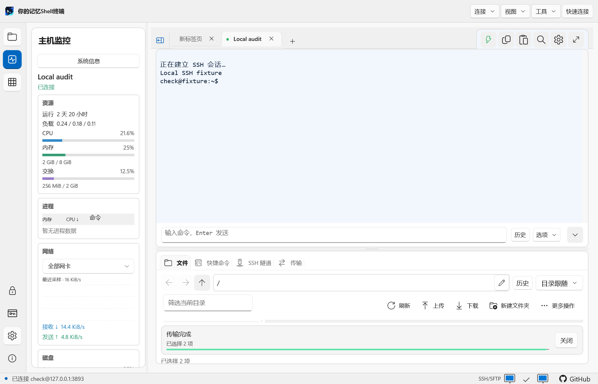
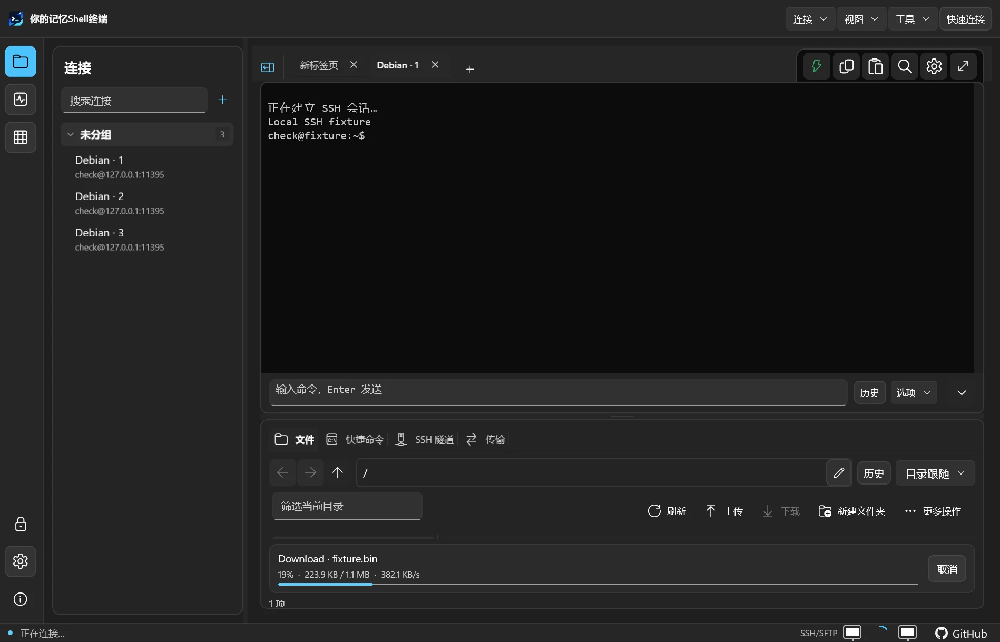
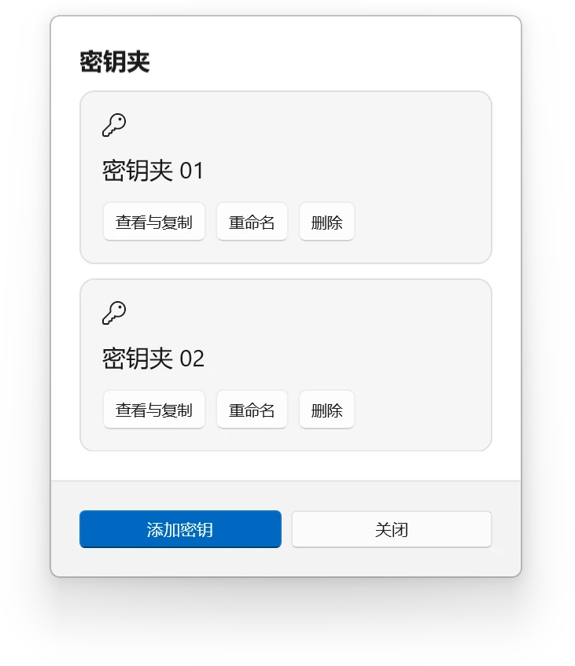
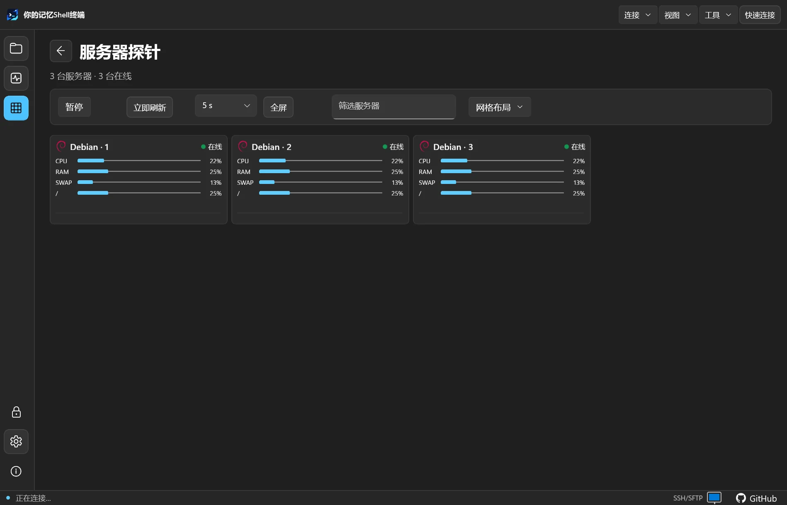
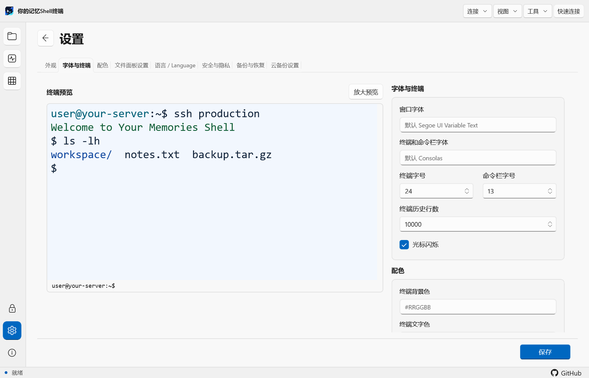

<p align="center">
  
</p>

<h1 align="center">你的记忆Shell终端</h1>

<p align="center">Your Memories Shell</p>
<p align="center">用WinUI3编写的Windows原生SSH客户端。</p>

<p align="center">
  <a href="https://github.com/YuXia-Net/Your-Memories-Shell/releases/latest">下载</a> ·
  <a href="https://github.com/YuXia-Net/Your-Memories-Shell/releases">更新记录</a> ·
  <a href="LICENSE">MIT许可证</a>
</p>

## 开始使用

支持Windows10 2004及以上版本、Windows11，运行架构为x64。

从发布页下载压缩包，解压后运行`Your-Memories-Shell.exe`。首次打开时选择语言、设置数据库密码，再添加SSH连接即可使用。[下载最新版本](https://github.com/YuXia-Net/Your-Memories-Shell/releases/latest)

程序自带运行组件，免安装，无需注册账号，也可以在局域网中使用。

首次启动可以一并设置主题、工具栏位置和启动锁。这些选项也能在之后的设置页面中调整。

## 终端与连接

一台主机一个标签页。连接列表支持分组和搜索，最近使用的连接可以从首页直接打开。右键连接即可编辑资料或执行连接操作，演示时也可以隐藏界面中的IP、端口和用户名。

终端可以直接输入，也可以在底部命令框中编辑后按Enter发送。常用指令保存到“快捷命令”，之前输入过的命令可以从历史记录中查找。

- 支持密码和私钥登录。
- 工具栏提供连接或断开、复制、粘贴、查找和当前会话设置。
- 重连沿用当前标签，保留之前的输出，并定位到最新内容。
- 输出默认跟随到底部。手动向上滚动后，保持当前阅读位置，回到底部后恢复跟随。
- 下方的文件、快捷命令、SSH隧道和传输面板可以收起，也可以单独放大终端。



## 文件管理与传输

连接后即可通过SFTP浏览远程目录。文件面板支持文件树和资源管理器两种布局，可以前进、后退、返回上级目录，也可以直接输入路径。

上传、下载、新建文件夹、重命名和删除都在文件面板中完成。支持多选文件、传输整个文件夹，并可选择如何处理同名文件，包括跳过、替换、自动重命名和合并文件夹。

传输时会显示进度和速度，底部SSH/SFTP图标也会显示传输状态。完成后发送Windows通知。切换到设置或其他页面时，正在进行的传输会继续。



## 代理、跳板与隧道

连接设置中可以单独启用代理或SSH跳板，也可以组合使用。

| 连接方式 | 支持内容 |
| --- | --- |
| HTTP CONNECT | 代理地址、端口及用户名密码认证 |
| SOCKS4 | 代理地址、端口及用户ID |
| SOCKS5 | 免认证或用户名密码认证 |
| SSH跳板 | 密码、私钥登录，以及引用保险库中的已有连接 |

常用代理和手动填写的跳板可以保存为预设，添加其他连接时直接选择。代理地址支持粘贴完整URL或“主机:端口”。

从保险库选择跳板后，手动填写项会收起。保存的是这条连接的引用，每次连接读取它最新的地址、端口和凭据。原连接使用的代理或上一级跳板也会沿用。

“测试SSH线路”可以检查当前代理、跳板到目标SSH服务的连通性。首次使用跳板时，先连接并核对它的主机指纹。

需要端口转发时，在会话下方打开“SSH隧道”。支持本地转发、远程转发和动态转发。

## 密钥夹

密钥夹入口位于侧栏的锁定按钮下方。导入私钥时可以自定义名称，例如“家里的服务器”或“开发环境”，之后在连接设置里按名称选用。

使用私钥登录时，默认勾选“保存密码到保险库/保存密钥到密钥夹”。勾选后，私钥会导入数据库并出现在密钥夹中，以后连接使用数据库内的副本。取消勾选则保留本地文件路径，下次连接继续读取该文件。

密钥夹支持重命名、删除、查看和复制。查看完整私钥时输入数据库密码即可。

<p align="center">
  
</p>

## 主机监控与服务器探针

当前会话的主机监控显示运行时间、负载、CPU、内存、交换空间、进程、网络和磁盘信息，方便在操作终端时一起查看。

需要同时查看多台主机时，在连接设置中勾选“加入服务器探针”，再打开侧栏的探针页面。每台服务器显示为一张卡片，用进度条呈现资源占用，并显示在线状态和系统图标。

网格行列数、卡片占用格数和显示标签都可以调整，也可以筛选服务器、修改刷新间隔或全屏查看。探针使用保存的连接凭据，通过SSH读取Linux系统状态，服务器端无需额外安装软件。



## 主题与布局

内置Windows浅色、Windows深色和你的记忆三种主题。窗口字体、终端字体、字号、文字颜色、背景和历史行数可以分别调整，终端预览会随设置实时更新，也支持放大预览。

终端工具栏有三种位置可选，标签栏左侧、标签栏右侧、命令输入框旁。放在标签栏时，按钮固定在对应边缘，标签从另一侧排列。收起下方面板的按钮始终位于命令框旁。

顶栏也可以交换LOGO和按钮的位置。调整好的外观可以保存为方案，之后直接切换。



界面支持简体中文、繁体中文、英语、日语、韩语、德语、法语和西班牙语。首次打开选择语言，之后可在设置中更改。

## 数据库与备份

连接、凭据、密钥夹和历史记录保存在本机加密数据库中，采用AES-256-GCM加密。数据库密码用于查看、导出凭据和恢复备份。

同一个Windows账户下，日常打开软件和连接主机使用本机保存的解锁信息。需要在启动时验证身份，可以另外启用PIN或九宫格图案锁。启动锁在“安全与隐私”中设置，支持鼠标和触屏绘制图案。

“备份与恢复”提供数据库导出、恢复和存储位置设置。导出的数据库备份可用原数据库密码恢复。连接资料也能导出为Excel表格，表格中包含解密后的地址、用户名、密码和私钥等信息。

云备份支持WebDAV、FTP、FTPS和S3兼容存储，上传的是加密数据库。填写自己的存储服务地址和认证信息后，可以手动备份，也可以选择程序运行期间自动备份。

| 备份策略 | 执行时间 |
| --- | --- |
| 定时备份 | 按设定的时间间隔备份 |
| 数据更新后备份 | 数据保存后触发备份 |

## 文件位置与升级

默认目录位于程序旁边。

```text
Your-Memories-Shell.exe
Workspace/
├─ data/       数据库
└─ Custom/     主题、字体、背景等自定义设置
```

升级时关闭程序，替换可执行文件并保留`Workspace`文件夹。数据库存储目录可以在“备份与恢复”中修改。

如果已经改过数据库位置，继续使用自己选择的目录即可。

换电脑时，先导出数据库备份，在新电脑上用数据库密码恢复。主题、字体和背景等自定义文件可以一并复制`Workspace/Custom`文件夹。

## 从源码构建

在Windows上安装.NET 8 SDK和Windows SDK，进入项目目录，在PowerShell中运行。

```powershell
git clone https://github.com/YuXia-Net/Your-Memories-Shell.git
cd Your-Memories-Shell
./Build.ps1
```

首次构建会下载NuGet依赖。生成的程序和压缩包位于`Release`目录，也可以用Visual Studio打开`MemoryShell.sln`，选择x64构建。

可以通过参数指定输出目录。

```powershell
./Build.ps1 -OutputPath Release/MyBuild
```

已有依赖缓存时，可以添加`-NoRestore`跳过依赖还原。输出目录需使用新的名称。

主要代码位于`MemoryShell`目录。界面使用WinUI3，SSH与SFTP连接使用SSH.NET，数据库使用SQLite。八种语言的文本位于`MemoryShell/Localization`。

## 许可证

本项目采用MIT许可证，允许修改、分发和商用，保留版权及许可声明即可。第三方组件的许可见单独说明。[LICENSE](LICENSE) · [第三方组件](THIRD_PARTY_NOTICES.md)
